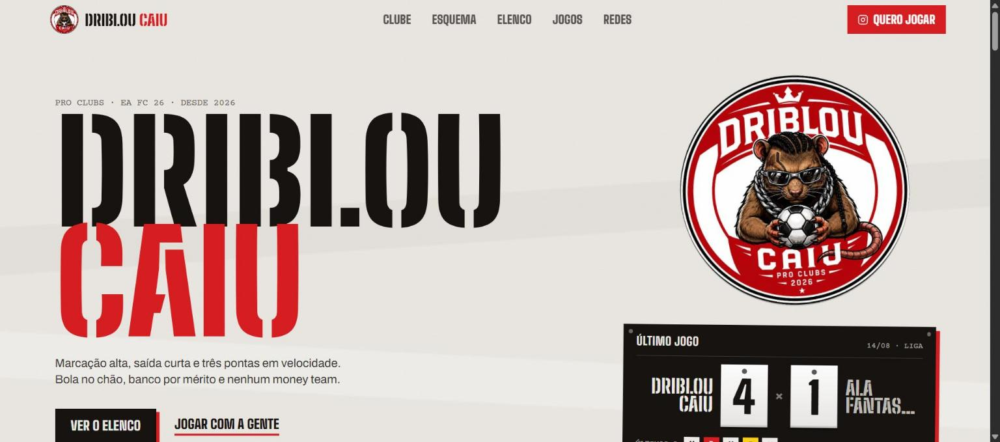

# Driblou Caiu FC

**Landing page de clube de Pro Clubs** · React · TanStack Start

[](https://dribloucaiu-landing.vercel.app)
[](https://react.dev)
[](LICENSE)

Site oficial do **Driblou Caiu**, clube de Pro Clubs no **EA FC 26**: elenco, esquema tático interativo, jogos e redes sociais do time, com identidade visual de **futebol de várzea**: muro caiado com estêncil, placar de chapa, álbum de figurinhas, lambe-lambe e súmula datilografada.

🔗 **Site no ar:** [dribloucaiu-landing.vercel.app](https://dribloucaiu-landing.vercel.app)



## Sobre o projeto

A identidade parte do escudo e do lugar de onde o futebol do time vem: a várzea. O site é o muro do campo, com o nome pintado em estêncil (Big Shoulders Stencil), o último resultado num placar de chapinhas penduradas no prego, o elenco como página de álbum de figurinhas, o próximo jogo como cartaz lambe-lambe amarelo e os resultados numa súmula em máquina de escrever (Courier Prime). A paleta usa só as cores do jogo: cal, vermelho do escudo, preto piche, amarelo cartão e verde gramado.

## Seções

- **Início**: nome pintado no muro, escudo e placar de chapa com o último jogo e a forma recente
- **Números**: jogos, vitórias, gols, saldo e aproveitamento, calculados a partir das partidas
- **Clube**: manifesto, regras da casa e lema
- **Esquema**: campo tático interativo, com 8 formações e jogadores arrastáveis
- **Elenco**: álbum de figurinhas; toque na figurinha para ver a ficha do jogador
- **Próximo jogo**: lambe-lambe com data, adversário e contagem regressiva
- **Jogos**: súmula com resultados (gols, assistências e craque do jogo), tabela da liga e artilharia
- **Redes**: Instagram e TikTok do clube

## Painel admin (atualizar o site sem mexer no código)

Em `/admin` (protegido por senha) dá pra registrar partidas com placar, gols e assistências por jogador, definir o próximo jogo, editar o elenco (stats e foto), a tabela da liga e o histórico. Artilharia, aproveitamento e contadores do site são calculados sozinhos a partir das partidas.

Os dados ficam num Redis (Upstash) acessado por REST. Configuração na Vercel:

1. **Storage → Marketplace → Upstash Redis** e conecte ao projeto (cria `KV_REST_API_URL` e `KV_REST_API_TOKEN`).
2. **Settings → Environment Variables**: crie `ADMIN_PASSWORD` com a senha do painel (e, opcionalmente, `ADMIN_SECRET`, um texto aleatório longo que assina a sessão).
3. Faça um novo deploy.

Sem Redis o site continua funcionando com os dados iniciais (`src/data/team.ts`), só não dá pra salvar. Em desenvolvimento (`bun run dev`) os dados vão para `.data/db.json` e a senha padrão é `driblou`.

## Fotos do elenco

As fotos embutidas vêm de prints da carta de cada jogador no jogo. `scripts/crop-stickers.mjs` recorta cabeça e tronco no formato de figurinha, a partir dos prints em `scripts/player-sources/`:

```bash
node scripts/crop-stickers.mjs scripts/player-sources src/assets/players
```

Uma foto enviada pelo painel admin substitui a embutida.

## Stack

- **[TanStack Start](https://tanstack.com/start)**, React 19 + SSR
- **[TanStack Router](https://tanstack.com/router)**, roteamento
- **[Tailwind CSS 4](https://tailwindcss.com/)**, estilização utilitária
- **[Framer Motion](https://www.framer.com/motion/)**, animações e drag-and-drop do esquema tático
- **[Radix UI](https://www.radix-ui.com/)**, componentes acessíveis
- **[Vite 8](https://vite.dev/)** + **[Nitro](https://nitro.build/)**, build e servidor
- **[Bun](https://bun.sh/)**, runtime e gerenciador de pacotes

## Como rodar

Requer [Bun](https://bun.sh) (ou Node.js + npm).

```bash
git clone https://github.com/joaobatis1a/dribloucaiu-landing.git
cd dribloucaiu-landing
bun install
bun run dev
```

Acesse `http://localhost:3000`.

### Outros comandos

```bash
bun run build     # build de produção
bun run preview   # pré-visualiza o build de produção localmente
bun run lint      # eslint
bun run format    # prettier
```

## Deploy

O projeto já está configurado pra rodar tanto na Vercel quanto no Cloudflare (via Nitro, que troca de preset automaticamente pela variável de ambiente `VERCEL`):

1. Conecte o repositório na plataforma escolhida
2. Build command: `bun run build`
3. Deploy automático a cada `git push` na branch `main`

## Estrutura

```
src/
├── components/
│   ├── Hero.tsx
│   ├── TeamStats.tsx
│   ├── About.tsx
│   ├── Formation.tsx       # esquema tático interativo
│   ├── Squad.tsx           # grade do elenco
│   ├── PlayerCard.tsx      # card individual do jogador
│   ├── Friendlies.tsx      # amistosos
│   ├── SocialLinks.tsx
│   ├── Navbar.tsx
│   ├── SiteFooter.tsx
│   └── ScrollToTop.tsx
├── data/
│   └── team.ts             # elenco, resultados e dados do clube
├── lib/
│   ├── formations.ts       # posições de cada esquema tático
│   └── match.ts            # raridade dos cards e helpers de partida
├── assets/players/          # fotos dos jogadores
└── routes/                  # rotas do TanStack Router
```

## Autor

**João Batista da Silva Neto**
Desenvolvedor Front-End

- GitHub: [@joaobatis1a](https://github.com/joaobatis1a)
- LinkedIn: [joao-batista-silva-neto](https://linkedin.com/in/joao-batista-silva-neto)
- E-mail: [profissionalba1is1a@gmail.com](mailto:profissionalba1is1a@gmail.com)

## Licença

Distribuído sob a licença MIT. Veja [`LICENSE`](LICENSE) para mais detalhes.
